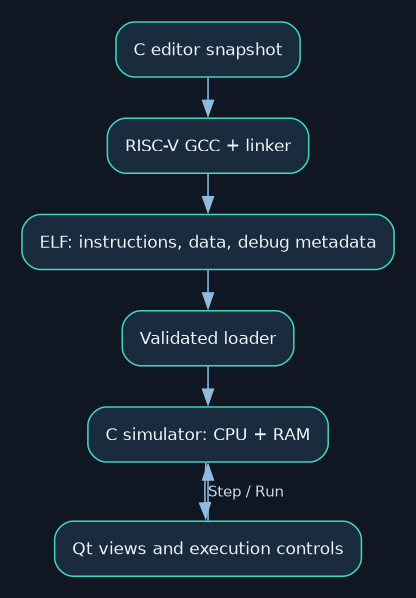
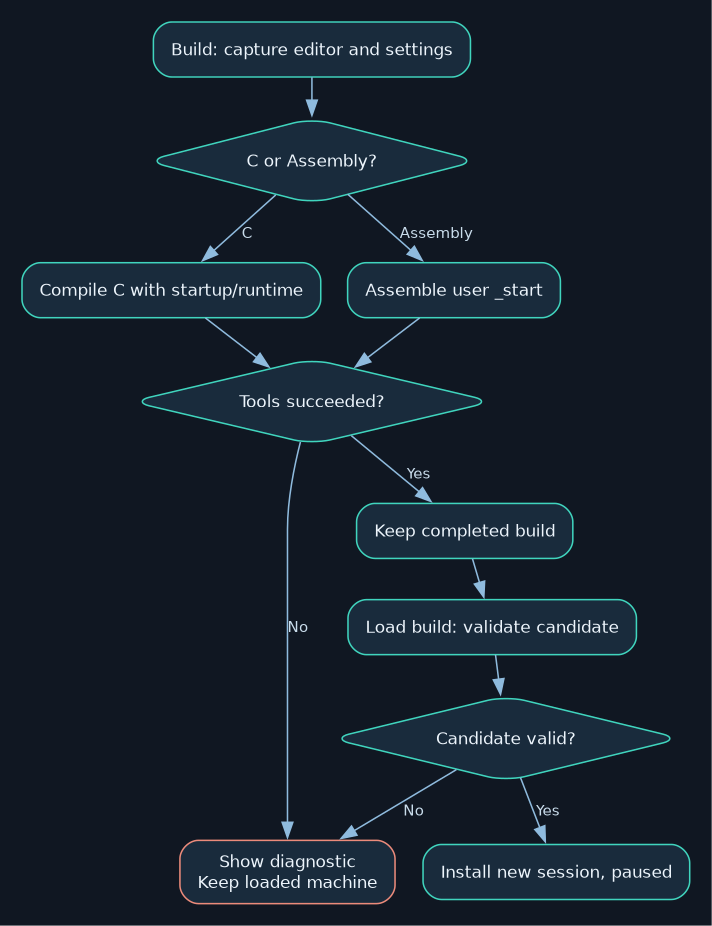

# How RISC-V Studio works

This guide explains the software. [How RISC-V works](HOW_RISCV_WORKS.md) explains
the machine model; [How to use](HOW_TO_USE.md) contains complete operating steps.

## 1. Three different programs take part

The host runs the Studio executable. Studio invokes a cross compiler that
produces instructions for a different processor: RV32I. The C simulator then
executes those guest instructions against its own register array and RAM buffer.

For example, a Windows x86-64 computer runs a native Windows Studio executable.
The compiled lesson is RV32I code, and never executes directly on the Windows CPU.
It executes inside the simulator.

## 2. Software layers

| Layer | Responsibility |
| --- | --- |
| CPU | Fetch, decode, perform one instruction, commit effects, report faults. |
| Memory | Own the RAM buffer; check address ranges and alignment; read/write bytes and words. |
| Program loader | Read words, ELF or binary; validate layout and construct the initial image. |
| Machine controller | Hold current/initial state; apply execution limits, reset and exit semantics. |
| Debug metadata | Own symbols, file names and instruction/source ranges. |
| Debugger | Decide stopping conditions, manage breakpoints and retain reversible records. |
| Inspector | Evaluate supported DWARF locations and reconstruct available call frames. |
| Analysis | Traverse initial code and build static blocks, calls and references. |
| Desktop session | Own these components and translate their results into views and user actions. |

The execution, debugger and analysis core is C17. Qt widgets and orchestration
are C++17. Runtime C files compiled into the lesson are separate from the C files
that implement the simulator.

## 3. Build is a transaction

**Build** takes a copy of the current editor text. It does not overwrite the saved
source file and does not replace the currently loaded machine. The builder writes
that snapshot to a private working directory and runs the cross toolchain.

C compilation selects RV32I, ILP32, freestanding C17, debug metadata, and the chosen
optimization profile. A generated linker script places the program at 0x1000 and
reserves stack space at the RAM end. Startup code and memory helpers are linked
with the lesson. Supported integer compiler helpers come from libgcc.

Standalone Assembly has a separate path. It assembles the user's _start and
does not insert C startup or initialize the stack. Uppercase .S uses preprocessing.

A build is loadable only while its editor text and build settings still match.
**Build > Save build ELF** can save the completed result before loading.
**Build & load** combines compilation and loading but still leaves execution
paused. **Run** starts execution.

## 4. Loading and reset

ELF segments supply addresses, file-backed bytes, zero-filled memory sizes and
an entry point. Raw binary supplies only bytes, so its load address and entry
must be given separately. The loader checks architecture, capacity and layout.

A replacement is prepared independently. If allocation, parsing or validation
fails, the previous session remains available. On success, a session owns an
initial memory image and a current memory image. Reset copies the initial image
back into current RAM and restores the initial CPU. It clears execution history
and keeps the session's breakpoints.

Export uses the initial image. A project save can preserve the current CPU/RAM,
including execution effects. These two forms of persistence serve different jobs.

## 5. What Step actually calls

A machine step asks the C CPU to execute one instruction. The CPU reads four
bytes at PC, decodes the word, reads source registers, calculates effects and
checks accesses before committing changes. A normal step advances PC by four;
a taken branch or jump supplies another PC.

The CPU returns a result and, when requested, an execution record. The controller
recognizes the teaching environment's exit request. The debugger records enough
state to undo/replay supported machine effects. The views then read the new state.

A trap preserves the faulting instruction location and reports the reason.
A rejected access does not partly overwrite a word. The inspector's **Last
executed** section is separate from the Assembly marker for the next instruction.

## 6. Why C and Assembly highlights differ

DWARF associates instruction addresses with source locations. It is a mapping
provided by the compiler, not a reverse translation performed by Studio.

- One line may map to several instructions.
- Consecutive instructions may retain the same C highlight.
- Several source constructs may share one machine operation.
- Comments, declarations and some statements have no mapped instruction.
- Optimized code can move, merge or remove operations.
- Startup and library instructions may refer to other files.
- Missing metadata cannot be reconstructed merely from source text.

The source selector separates the editable file from the exact built snapshot
and available support files. A path in ELF does not guarantee that its file
exists. Unavailable entries are counted and omitted from the selectable list.
External text without a captured build snapshot is labeled unverified.

Selecting a source or instruction changes inspection. It does not change PC.
Returning to **PC / Follow PC** resumes following the next instruction.

## 7. Execution scheduling and responsiveness

The GUI owns machine execution on its event thread. A timer schedules small
batches. Each batch stops at its instruction/time budget, then returns to the
event loop so buttons, paint events and Pause can be handled.

Speed is a requested execution rate. Unlimited still yields between batches.
It is not a CPU frequency or timing model. Register/RAM highlights summarize
the latest display update, which can contain several instructions. A value can
change and return within one update; a restored marker makes that visible.

Compilation uses asynchronous child processes. Linux compiler children are
started in a separate process session so cancellation can stop their group.
ELF loading and other expensive preparation use workers; a completed valid
session is installed on the GUI thread.

## 8. Debugger and history

Instruction Step is explicit. Run and source/function controls apply stopping
rules for breakpoints, exit, traps, cancellation and the run limit. Into C stops
at a different mapped location; Over also follows the observed call depth; Out
waits for the observed caller.

The call model recognizes conventional link registers and return instructions.
Hand-written nonstandard calling conventions can exceed that model. Optimized
inline functions do not create separate physical calls.

History is a bounded ring of machine events. Back restores earlier recorded
CPU/RAM states; Replay restores retained future states without executing their
instructions again. Continuing with new execution after going back replaces
the recorded future. When the buffer is full, the oldest entries are discarded.
Changing its capacity clears the retained history.

Variables are evaluated from debug descriptions, registers and RAM while paused.
Missing, unsupported or optimized-away locations remain unavailable. A symbol's
address is not sufficient to recover every source variable.

## 9. Compare owns two machines

Compare freezes one C editor snapshot and builds it at -O0 and -O2. Each side owns
its CPU, RAM, metadata, breakpoints and history. Stepping one side leaves the other
side unchanged. They run independently and need not have matching PCs or stack
layouts at equivalent source points.

The comparison table examines common data symbols when both sides are paused.
Matching output for the chosen input is evidence for that run, not a proof of
program equivalence for all inputs. External headers remain build inputs and
should remain unchanged while the pair compiles.

## 10. Static analysis

The analyzer reads the initial executable image and follows known instruction
targets. It creates basic blocks, potential branches, conventional calls and
references. Simple adjacent register patterns can resolve some addresses;
unknown indirect targets remain unknown.

Static paths are possibilities, not a record of executed branches. Data bytes
can look like valid instructions, especially in raw binary. Limits bound the
number of instructions, entries, references and rendered nodes. Partial analysis
is explicitly identified.

Experimental pseudocode expresses low-level register operations with labels,
jumps and memory helpers. It is not the original C or a compilable reconstruction.

## 11. Projects and safe file replacement

A .rv32project saves the main editor, loaded image, available source snapshots,
current machine state, breakpoints, retained history and selected workspace
settings. Opening validates the archive before replacing the current session
and reconstructs sources in private storage. It never writes over original
source paths. The restored machine starts paused.

Compare sessions and the compiler installation are not stored in the project.
Save source preserves text; export preserves the initial program; Save project
preserves the main debugging session. File writes use atomic replacement where
supported, so a rejected save does not deliberately replace an existing file.

## 12. Platform packaging

The same C machine runs in Windows and Linux builds. Linux uses the system's
ELF/DWARF libraries; Windows uses the bundled Python/pyelftools bridge to obtain
metadata. The Windows compiler and Python runtime are bundled for offline builds.

The installer and portable ZIP keep those files in an ordinary application
folder. The single EXE stores a compressed copy, extracts a temporary workspace,
then launches the application. Extraction changes startup behavior and disk use,
not simulator features. The supplied folder distribution also allows replacement
of compatible shared libraries under their own license terms.

## Further reading

- [Hardware model](HOW_RISCV_WORKS.md)
- [User manual](HOW_TO_USE.md)
- [Detailed workflows](docs/FLOWCHARTS.md)
- [Qt process handling](https://doc.qt.io/qt-6/qprocess.html)
- [Qt shared-library deployment](https://doc.qt.io/qt-6/deployment.html)
