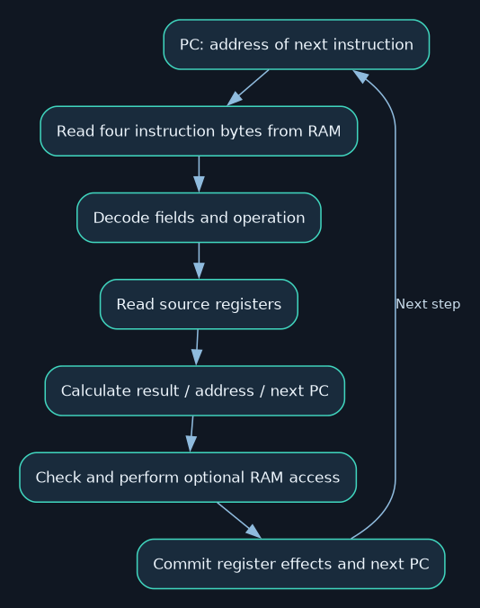
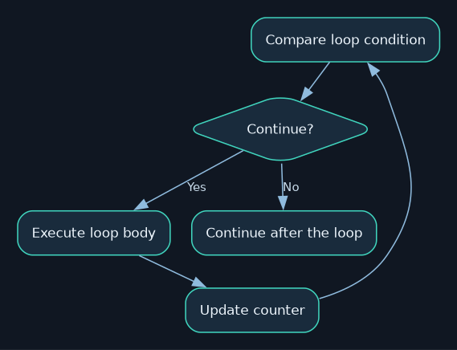

# How RISC-V works

This guide describes the RV32I machine implemented inside RISC-V Studio.
It connects the instruction encoding to what appears in Assembly, Registers,
Memory and Instruction details. For the application itself, read
[How it works](HOW_IT_WORKS.md).

## 1. The processor sees bits

C names and expressions help people write programs. A compiler turns those
expressions into instructions. The simulator reads instruction bytes from RAM,
decodes their fields, reads registers and performs the specified operation.

RISC-V is an instruction-set architecture: an agreement about visible processor
state and instruction behavior. Different physical processors can implement it
with different circuits. This application implements the behavior in C, with
one simulated execution context. It does not implement a clocked transistor or
pipeline model.

**RV32I** means the base integer instruction set with 32-bit integer registers.
The desktop can run on a 64-bit computer while simulating this 32-bit machine.

## 2. Registers and PC

A general register stores 32 bits. There are 32 registers, x0 through x31.
x0 always reads zero; writes to x0 are discarded. The other registers hold
ordinary bit patterns. They do not store a permanent signed/unsigned type.

PC is separate. It contains the address of the instruction to execute next.
Most RV32I instructions finish with PC = old PC + 4 because every instruction
is four bytes. Jumps and taken branches change this rule.

| Architectural register | Common ABI name | Conventional purpose |
| --- | --- | --- |
| x0 | zero | Constant zero. |
| x1 | ra | Return address. |
| x2 | sp | Stack pointer. |
| x3 | gp | Global pointer. |
| x4 | tp | Thread pointer convention; no thread runtime is provided here. |
| x5-x7 | t0-t2 | Temporary values. |
| x8 | s0 / fp | Saved value or frame pointer. |
| x9 | s1 | Saved value. |
| x10-x17 | a0-a7 | Arguments; a0/a1 can hold return values. |
| x18-x27 | s2-s11 | Saved values. |
| x28-x31 | t3-t6 | Temporary values. |

The hardware numbers x0-x31 identify registers. Names such as sp or a0 express
calling conventions. A function must preserve the callee-saved registers it
uses; it can overwrite caller-saved registers. The caller saves values it needs
to keep across that call. sp is conventionally restored before returning.

## 3. Signed and unsigned are interpretations

Take the exact same bits:

~~~text
11111111 11111111 11111111 11111111
hexadecimal: 0xFFFFFFFF
unsigned:   4294967295
signed:     -1
~~~

Unsigned interpretation gives each bit its positive positional value. Signed
two's-complement interpretation subtracts 2^32 when bit 31 is set.

| Bits | Unsigned decimal | Signed decimal |
| --- | ---: | ---: |
| 0x00000001 | 1 | 1 |
| 0x7FFFFFFF | 2147483647 | 2147483647 |
| 0x80000000 | 2147483648 | -2147483648 |
| 0xFFFFFFFD | 4294967293 | -3 |
| 0xFFFFFFFF | 4294967295 | -1 |

The chosen instruction decides how to interpret operands when interpretation
matters. **BLT** compares signed values; **BLTU** compares unsigned values.
The register with bits 0xFFFFFFFF is less than 2 for BLT and greater than 2 for
BLTU. Choosing Signed in the UI changes presentation only.

ADD and SUB retain the low 32 bits. Adding 1 to 0xFFFFFFFF produces 0.
There is no RV32I arithmetic overflow flag. This machine rule is distinct from
C rules: unsigned C arithmetic wraps, while signed C overflow is undefined and
must not be used to predict what an optimizing compiler will emit.

## 4. RAM addresses, bytes and words

RAM is a sequence of bytes. An address selects one byte. A byte has 8 bits;
an RV32I register and a word have 32 bits, or four bytes.

The simulator stores words in little-endian order:

| Address | Byte for word 0x12345678 |
| --- | --- |
| A | 78 |
| A + 1 | 56 |
| A + 2 | 34 |
| A + 3 | 12 |

Reading LW at A reconstructs the word 0x12345678. SW writes the four bytes.
LB/LBU read one byte, LH/LHU read two, and LW reads four. Signed LB/LH extend
the top loaded bit; LBU/LHU fill the high bits with zeros. For the byte FF,
LB produces 0xFFFFFFFF and LBU produces 0x000000FF.

SB and SH store the low 8 or 16 bits of their source register. A load into x0
still performs its memory access and can fault even though the value is discarded.

### Installed RAM versus possible addresses

A 32-bit address has values from 0x00000000 to 0xFFFFFFFF. That represents
4 GiB of possible byte addresses. The program does not allocate 4 GiB simply
because its registers are 32 bits.

| Configured RAM | Bytes | Last valid byte |
| --- | ---: | --- |
| 64 KiB | 65536 | 0x0000FFFF |
| 128 KiB | 131072 | 0x0001FFFF |
| 1 MiB | 1048576 | 0x000FFFFF |
| 256 MiB | 268435456 | 0x0FFFFFFF |

This implementation caps allocated RAM at 256 MiB. The last valid byte is
always capacity minus one. Every byte of an access must fit. With 64 KiB,
the final aligned word starts at 0x0000FFFC and occupies bytes through 0xFFFF.

More RAM allows larger valid addresses and more code, globals and stack space.
It does not increase the speed or width of an instruction. Memory's Go field
only navigates existing RAM; it does not allocate additional memory.

### Why the program starts at 0x1000

The supplied linker layout places program sections at 4096, hexadecimal 0x1000.
RAM still begins at zero. The first 4 KiB are left outside the normal linked
program, but remain accessible in this flat model. There is no protected null
page. A different imported ELF or raw load can specify another valid layout.

### KiB and MiB

KiB = 1024 bytes and MiB = 1048576 bytes. kB = 1000 bytes and MB = 1000000 bytes.
The application accepts these distinct units so a capacity is unambiguous.

## 5. Instruction fields and formats

Each RV32I instruction is a 32-bit word. Bits are numbered 31 down to 0.
The opcode in bits 6..0 selects a broad operation group. Other fields select
registers, a more specific operation, or an immediate constant.

| Field | Meaning |
| --- | --- |
| rd | Destination register number. |
| rs1 | First source/base register number. |
| rs2 | Second source register number. |
| funct3 / funct7 | Additional operation selection bits. |
| imm | Constant or displacement encoded inside the instruction. |

There are four basic layouts, with branch and jump immediate variants commonly
named B and J. Studio presents **R, I, S, B, U and J**.

| Format | Bits from high to low | Typical use |
| --- | --- | --- |
| R | funct7 / rs2 / rs1 / funct3 / rd / opcode | Register-to-register arithmetic. |
| I | imm[11:0] / rs1 / funct3 / rd / opcode | Immediate arithmetic, loads, JALR. |
| S | imm[11:5] / rs2 / rs1 / funct3 / imm[4:0] / opcode | Stores. |
| B | imm[12,10:5] / rs2 / rs1 / funct3 / imm[4:1,11] / opcode | Conditional branches. |
| U | imm[31:12] / rd / opcode | Construct an upper immediate or PC-relative base. |
| J | imm[20,10:1,11,19:12] / rd / opcode | Direct jump with return-address storage. |

Register numbers use five bits. I/S offsets normally use a signed 12-bit value,
from -2048 to 2047. U supplies the upper 20 bits with twelve zeros below.
B and J rearrange immediate bits; the decoder reconstructs them and supplies
the low zero bit. Shift-immediate instructions have their own operation/shift
fields within the I layout.

### Decode ADDI by hand

~~~text
addi x5, x0, 5

word:      0x00500293
format:    I
opcode:    0x13
rd:        5
funct3:    0
rs1:       0
immediate: 5
effect:    x5 = x0 + 5 = 5
~~~

The first byte stored in little-endian RAM is 93, followed by 02, 50, 00.
Instruction details show the word and fields so the displayed Assembly can be
checked against those bits.

## 6. Instruction families

| Family | RV32I operations | Effect |
| --- | --- | --- |
| Register arithmetic/logic | ADD, SUB, SLL, SLT, SLTU, XOR, SRL, SRA, OR, AND | Read two registers and write a result. |
| Immediate arithmetic/logic | ADDI, SLTI, SLTIU, XORI, ORI, ANDI, SLLI, SRLI, SRAI | Use a register and encoded immediate. |
| Loads | LB, LH, LW, LBU, LHU | Read RAM at base + signed offset. |
| Stores | SB, SH, SW | Write RAM at base + signed offset. |
| Conditional branches | BEQ, BNE, BLT, BGE, BLTU, BGEU | Compare registers and optionally add a displacement to PC. |
| Upper immediates | LUI, AUIPC | Form a constant or PC-relative value. |
| Jumps | JAL, JALR | Select another PC and optionally write a return address. |
| Ordering | FENCE | Order memory operations; already satisfied by this sequential model. |
| Environment | ECALL, EBREAK | Request environment handling or a breakpoint trap. |

SLT/SLTI write 1 or 0 after a signed comparison. SLTU/SLTIU compare unsigned
values; SLTIU still sign-extends its encoded immediate before that comparison.
SRA preserves the sign bit while shifting right. SRL shifts in zeros.
Register-controlled shifts use the low five bits of the shift count.

Pseudo-instructions such as li, mv, ret and j are assembler conveniences.
For example, mv can become ADDI with immediate zero, and ret becomes a JALR
using ra. A large li can expand into more than one real instruction.

## 7. Follow a complete machine example

This hand-written sequence deliberately chooses registers and addresses:

~~~asm
.option norvc
.text
.globl _start
_start:
    addi t0, zero, 5
    addi t1, zero, 7
    add  t2, t0, t1
    sw   t2, 256(zero)
    addi a0, zero, 0
    addi a7, zero, 93
    ecall
~~~

With the default origin and 64 KiB RAM:

| Step | PC before | Instruction | Visible effect |
| --- | --- | --- | --- |
| 1 | 0x1000 | addi x5, x0, 5 | x5 becomes 5; PC becomes 0x1004. |
| 2 | 0x1004 | addi x6, x0, 7 | x6 becomes 7; PC becomes 0x1008. |
| 3 | 0x1008 | add x7, x5, x6 | x7 becomes 12; PC becomes 0x100C. |
| 4 | 0x100C | sw x7, 256(x0) | RAM at 0x100 becomes 0C 00 00 00. |
| 5 | 0x1010 | addi x10, x0, 0 | a0 holds the exit code 0. |
| 6 | 0x1014 | addi x17, x0, 93 | a7 selects the teaching exit service. |
| 7 | 0x1018 | ecall | The controller reports program exit 0. |

C expressing the same addition need not produce this sequence or choose these
registers. The compiler chooses storage and instructions according to its inputs
and optimization settings. The machine follows the emitted words.

## 8. Branches, loops and calls

BEQ/BNE compare equality of bits. BLT/BGE use signed ordering; BLTU/BGEU use
unsigned ordering. A taken branch uses the old PC plus the signed displacement.
A non-taken branch continues at PC + 4.

JAL writes old PC + 4 into rd and jumps relative to old PC. JALR computes its
target from rs1 plus its immediate, clears target bit zero, and writes the return
address into rd. The target is calculated before writing rd, even if registers
overlap. In RV32I here, instruction targets must still be four-byte aligned.

A function call usually saves the return PC in ra. Its prologue can reserve stack
space and save registers. The epilogue restores them and returns through ra.
Recursion uses another frame for each active call unless compiler transformations
remove the physical calls.

## 9. Stack and startup

The stack is an ordinary region of RAM managed by program instructions.
It grows downward by convention. With 64 KiB, startup sets sp to 0x10000,
one byte beyond the last valid byte. A function subtracts its frame size before
storing data below that address. The initial ABI stack alignment is 16 bytes.

The Stack setting reserves a region in the linked memory layout. It is not
an extra memory allocation outside RAM and does not install a protection fence.
A program that goes beyond its reservation can overwrite other valid RAM before
it finally reaches an invalid address.

Startup in start.S initializes sp and gp, clears uninitialized global storage
(BSS), calls main, and requests exit with main's returned value. The .S suffix
selects preprocessed Assembly; .s skips preprocessing. Standalone Assembly
provides its own entry and setup.

## 10. Faults and environment behavior

| Event | Behavior in Studio |
| --- | --- |
| Unknown/unsupported instruction | Illegal-instruction fault. |
| Fetch from an invalid address | Instruction fetch fault. |
| Halfword at an odd address | Misaligned access fault. |
| Word at an address not divisible by four | Misaligned access fault. |
| Load/store extending outside allocated RAM | Access fault. |
| Taken jump/branch to a non-four-byte-aligned target | Instruction-target alignment fault. |
| ECALL with a7 = 93 | Exit request; a0 is the exit code. |
| Other ECALL | Unsupported environment request. |
| EBREAK | Breakpoint trap. |

Some physical RISC-V environments handle misaligned data accesses differently.
This simulator deliberately checks natural alignment. A branch that is not taken
does not fault merely because its unused target would be misaligned.

There are no general Linux syscalls, privileged modes, device interrupts,
memory-mapped peripheral devices or hosted C library here. Integer multiplication
and division written in C can call software helpers because the M extension is
not part of this machine. Floating-point source is outside the supported lesson
runtime; use integer examples.

## 11. What the display measures

**Retired** counts completed instructions according to the machine/controller's
recording rules. History records attempts and effects, including stopping events.
PC and instruction counts are useful for understanding execution; they are not
measurements of physical CPU cycles.

**Values** changes number formatting. **Speed** changes the simulator's schedule.
**RAM** changes allocated address capacity on the next load/build. **Build**
changes the compiler's optimization profile. None of these controls changes
RV32I into a different instruction set.

## References

- [RISC-V RV32I specification](https://docs.riscv.org/reference/isa/v20240411/unpriv/rv32.html)
- [RISC-V ELF ABI: register and calling conventions](https://riscv-non-isa.github.io/riscv-elf-psabi-doc/)
- [Complete operating examples](HOW_TO_USE.md)
- [Instruction descriptions and field examples](docs/HELP.md)
