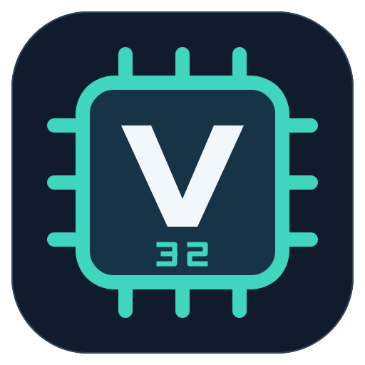
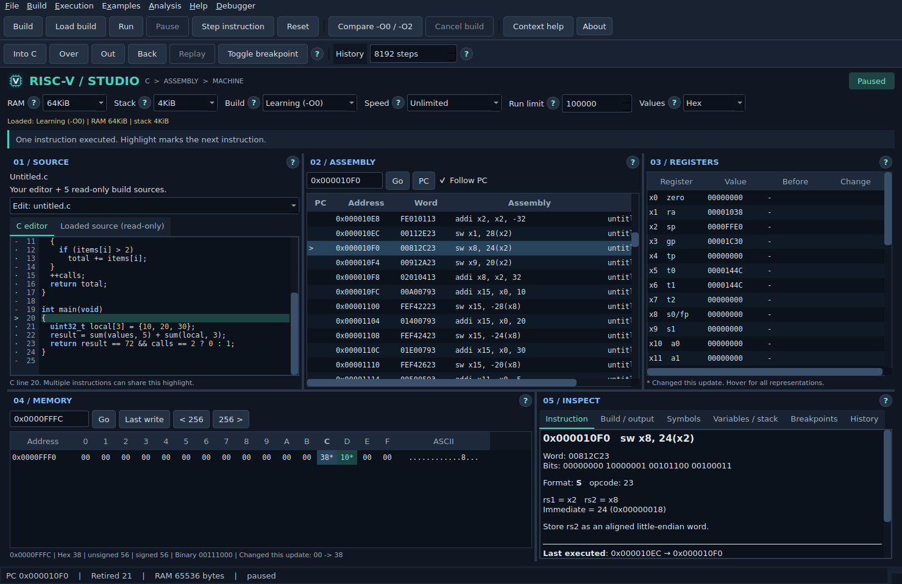
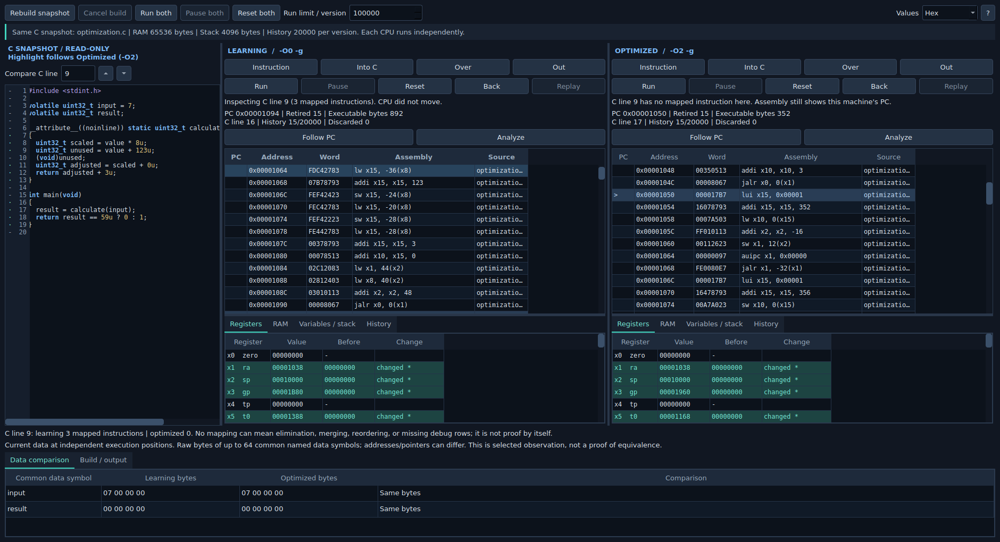

<p align="center"></p>

# RISC-V Studio

Write C or Assembly and follow a 32-bit RISC-V machine one instruction at a time.
See the current instruction, source mappings, registers, RAM, variables and call
stack together. Compare an unoptimized build with an optimized build and inspect
how the compiler changes the program.

The simulator implements RV32I in **C17**. The desktop interface uses **C++17 and
Qt 6**. The C execution core runs locally; no online service is needed to build,
execute or inspect the included examples.

**Free for personal and educational use, including public and private educational
institutions. Commercial use outside the educational permission requires prior
written authorization.** [Read the license](LICENSE.md).

This repository provides the official downloads, documentation and examples.
The desktop application's implementation and development history are not
published here.

## Download 1.0.0

| Platform | Download | How to open |
| --- | --- | --- |
| Windows 10/11 x64 | [Installer (recommended)](https://github.com/IcaroRamosDM/riscv32-studio/releases/download/v1.0.0/RISC-V-Studio-1.0.0-Windows-Setup.exe) | Run Setup, complete the installation, then open **RISC-V Studio** from Start. |
| Windows 10/11 x64 | [Portable ZIP](https://github.com/IcaroRamosDM/riscv32-studio/releases/download/v1.0.0/RISC-V-Studio-1.0.0-Windows-Portable.zip) | Extract the whole ZIP and open **RISC-V Studio.exe**. |
| Windows 10/11 x64 | [Single portable EXE](https://github.com/IcaroRamosDM/riscv32-studio/releases/download/v1.0.0/RISC-V-Studio-1.0.0-Windows-Portable.exe) | Run the EXE. It prepares a temporary workspace before opening. |
| Debian / Ubuntu amd64 | [DEB package](https://github.com/IcaroRamosDM/riscv32-studio/releases/download/v1.0.0/riscv32-studio_1.0.0_amd64.deb) | Install the package and find **RISC-V Studio** in the application menu. |
| Linux x86-64 | [Portable archive](https://github.com/IcaroRamosDM/riscv32-studio/releases/download/v1.0.0/riscv32-studio-1.0.0-linux-x86_64.tar.gz) | Extract it, install its listed system dependencies and open **RISC-V-Studio**. |

[All releases](https://github.com/IcaroRamosDM/riscv32-studio/releases) · [SHA-256 checksums](https://github.com/IcaroRamosDM/riscv32-studio/releases/download/v1.0.0/SHA256SUMS.txt) · [Installation guide](HOW_TO_USE.md#1-install-and-open)

All three Windows formats contain the same complete application, RISC-V compiler,
Python runtime, examples and offline manuals. No WSL or separate development-tool
installation is required. The portable ZIP avoids the single EXE's extraction
step. Save projects and source files in your own folder.

Linux packages use system-provided Qt, Python and RISC-V compiler dependencies.
The DEB targets Debian 12/13 and Ubuntu 24.04/26.04 with an x86-64 desktop.
Other Linux installations need the compatible libraries listed in
[Distribution](docs/DISTRIBUTION.md). ARM and 32-bit host binaries are not provided.

The unsigned Windows executables target Windows 10 and 11 x64.

GitHub's automatic **Source code** archives contain this repository's
presentation, documentation and examples. Use the application downloads above
for installation.

### Install the DEB

Open a terminal in the download directory and run:

```bash
sudo apt install ./riscv32-studio_1.0.0_amd64.deb
```

Then search for **RISC-V Studio** in the application menu. APT may need an internet
connection to obtain dependencies. The program's compilation and simulation
workflows run locally.

### Verify a download

Download **SHA256SUMS.txt** from the same release and compare the entry for your
chosen package with its local hash:

```powershell
Get-FileHash -Algorithm SHA256 .\RISC-V-Studio-1.0.0-Windows-Setup.exe
```

```bash
sha256sum riscv32-studio_1.0.0_amd64.deb
```

The 64 hexadecimal characters must match, ignoring letter case.

## Features
- All 40 RV32I base operations, 32 integer registers and checked little-endian RAM.
- C and GNU Assembly builds; separate Build, Load and Run actions.
- ELF, raw binary and annotated-word loading.
- Source/Assembly mapping with explicit missing or unavailable information.
- Changed registers and RAM shown with colors, markers and before/after values.
- Address and source breakpoints; instruction, line and function stepping.
- Bounded execution history with reversible CPU/RAM state.
- DWARF variable inspection, pointer navigation and call-frame reconstruction.
- Independent learning/optimized comparison sessions.
- Assembly-image, binary, ELF and listing exports; full main-session project saves.
- Static control flow, call graphs and cross-references.
- Integrated examples, searchable offline help and contextual explanations.

## Workspace



The Assembly marker follows each machine instruction. The highlighted C line
stays in place while its associated instructions execute. Register changes and
memory writes show what changed in the last step.

## Optimization comparison



Compare **Learning (-O0)** and **Optimized (-O2)** builds of the same source.
Inspect instruction counts and source mappings, and step each machine
independently. The compiler can merge, reorder or remove source operations.

## First run
1. Open **Examples > learning.c**.
2. Set **RAM = 64KiB**, **Stack = 4KiB**, **Build = Learning (-O0)**.
3. Click **Build** (Ctrl+B), then **Load build** (Ctrl+L).
4. Press **F6** to execute one Assembly instruction. The PC marker indicates the
   next instruction; several instructions can share one highlighted C line.
5. Set **Speed = Unlimited**, then press **F5**. The example exits with code **0**.
6. Open **Symbols**, double-click **result**, and inspect Memory: its four bytes
   are **48 00 00 00**, representing 72. The **calls** symbol contains 2.

Use **?** beside a control for a short explanation, or **F1** for offline help.

## Guides
| Document | What it explains |
| --- | --- |
| [How to use](HOW_TO_USE.md) | Installation, controls, complete examples, debugger, files and troubleshooting. |
| [How it works](HOW_IT_WORKS.md) | Software design, compiler workflow, execution, source mappings and project storage. |
| [How RISC-V works](HOW_RISCV_WORKS.md) | Registers, bits, instruction formats, RAM, the stack, branches and machine execution. |
| [Debugger](docs/DEBUGGER.md) | Breakpoints, C stepping, variables, frames, Back and Replay. |
| [Compare](docs/COMPARISON.md) | Independent -O0 and -O2 builds of the same C source. |
| [Files and projects](docs/FILES.md) | Assembly/ELF/binary import and export, project snapshots and RAM layout. |
| [Analysis](docs/ANALYSIS.md) | Control-flow graphs, calls, references and experimental pseudocode. |
| [Flowcharts](docs/FLOWCHARTS.md) | Execution and application workflows. |

## Machine scope
This is an instruction-level teaching simulator. It does not simulate transistor
timing, pipeline stalls, caches, peripherals, privileged execution or an operating
system. RV32M multiplication/division, compressed instructions, floating-point
extensions and general Linux system calls are outside its instruction set.
C multiplication/division can use linked software helpers.

RAM is configurable from 4 bytes to 256 MiB; C builds require aligned capacities
and enough room for code, data and stack. History retains up to 100000 events.
The stack reservation is a linker layout, without hardware protection.

Raw machine code does not contain the original C source. Experimental pseudocode
shows register-level operations and cannot restore the original program's names,
comments, types or structure. Optimization can also make variables unavailable.

## License
Free personal and educational use under the [application license](LICENSE.md).
Professional/commercial use outside its educational permission requires the
author's prior written authorization. This executable distribution is closed
source. [Third-party notices](THIRD_PARTY_NOTICES.md) describe the independent
licenses and source availability of its dependencies.


### Dependency sources

[Download the third-party source bundle](https://github.com/IcaroRamosDM/riscv32-studio/releases/download/v1.0.0/RISC-V-Studio-1.0.0-Third-Party-Sources.zip)
for the bundled dependencies, with its source index and checksums. It is provided
for source availability and license compliance and is not required to install
or run RISC-V Studio. Component notices are in
[THIRD_PARTY_NOTICES.md](THIRD_PARTY_NOTICES.md).

## Report a problem

[Open an issue](https://github.com/IcaroRamosDM/riscv32-studio/issues) with the application version,
operating system, steps to reproduce the problem, and the expected and observed
results. Include a small source example or screenshot when it helps explain the
problem. Only attach files that may be shared publicly.

## Author
**Icaro Ramos Rodrigues dos Santos**

Embedded Systems | Firmware | C | Hardware Design | STM32 | ARM Cortex-M | Linux | Verilog | UVM | Design Verification

GitHub: [https://github.com/IcaroRamosDM](https://github.com/IcaroRamosDM)<br>
LinkedIn: [https://www.linkedin.com/in/icaro-ramos-r/](https://www.linkedin.com/in/icaro-ramos-r/)<br>
[icaroelt@gmail.com](mailto:icaroelt@gmail.com)
