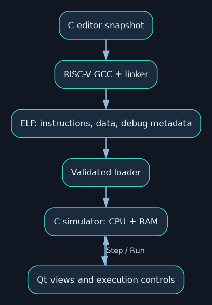
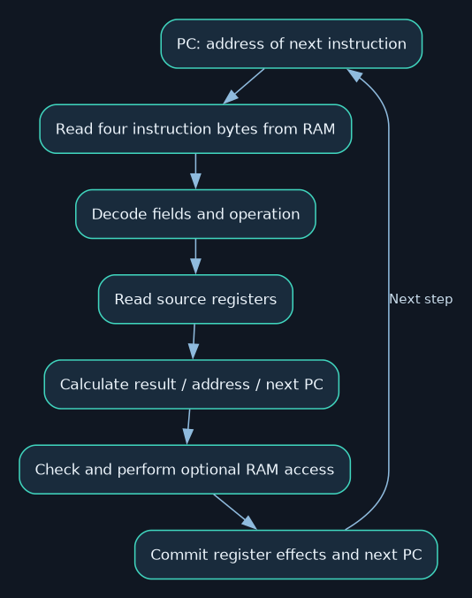
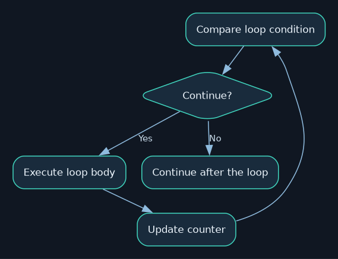

# Execution flowcharts

## From the editor to the machine

The editor holds your text. The compiler and linker produce an executable.
The loader prepares RAM and the CPU state. The simulator then executes one
instruction at a time, and the interface displays the result.

## Build and load

Build prepares an executable. Load initializes a session and leaves it paused.
Run and Step instruction control execution after loading.

## One processor step

Fetch reads the word at PC. Decode identifies the operation and operands.
Execution computes the result and checks access rules. A successful instruction
updates the architectural state; a trap reports why it could not complete.

## A loop

A conditional branch either continues the body or leaves the loop. The backward
transfer repeats the comparison. One C line can remain highlighted across
several Assembly instructions.

See [How the software works](../HOW_IT_WORKS.md),
[How RISC-V works](../HOW_RISCV_WORKS.md), and
[the complete user manual](../HOW_TO_USE.md) for worked examples.
