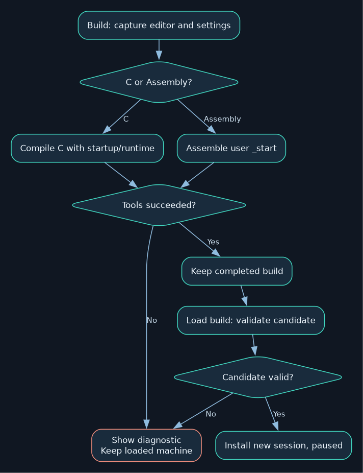

# Execution flowcharts

## From the editor to the machine


The editor holds your text. The compiler and linker produce an executable.
The loader prepares RAM and the CPU state. The simulator then executes one
instruction at a time, and the interface displays the result.

## Build and load



Build prepares an executable. Load initializes a session and leaves it paused.
Run and Step instruction control execution after loading.

## One processor step


Fetch reads the word at PC. Decode identifies the operation and operands.
Execution computes the result and checks access rules. A successful instruction
updates the architectural state; a trap reports why it could not complete.

## A loop


A conditional branch either continues the body or leaves the loop. The backward
transfer repeats the comparison. One C line can remain highlighted across
several Assembly instructions.

See [How the software works](../HOW_IT_WORKS.md),
[How RISC-V works](../HOW_RISCV_WORKS.md), and
[the complete user manual](../HOW_TO_USE.md) for worked examples.


## Reconstructing C from machine code (1.1.0)

```text
Loaded initial bytes
        |
        v
Decode reachable RV32/RV64 scalar instructions and control-flow edges
        |
        v
Propagate constants; merge disagreeing values as unknown
        |
        v
Remove unused pure calculations; preserve memory/environment effects
        |
        v
Recognize single-entry conditions/loops and constant text stores
        |
        v
Emit C + instruction-to-line map (retain explicit unknown operations)
        |
        v
F6 / Run / Back / Replay -> PC -> highlight reconstructed statement
```

The reconstruction reads the immutable program image. It does not drive the CPU
or replace the editable source. Changed instruction bytes disable its highlight.


## RV64 readable C

Scalar reconstruction preserves 64-bit constants and addresses, signed word
results, eight-byte memory accesses and compressed RV64 instructions. Guarded
jump tables may use absolute 64-bit entries or relative signed 32-bit entries.
High addresses stay visible in references and JSON; they never navigate to an
unrelated low address. Candidate input types and offsets retain the selected
register width, with decimal strings for JSON offsets outside its exact range.

Pure integer functions export as self-contained C17. Only needed portable
arithmetic helpers are emitted. CSR, atomic, floating, call and trap operations
remain explicit shared-machine-context boundaries; inferred C is not the
original source and does not replace the simulator's precise fault model.
The separate-functions manifest version 2 adds `xlen`; older project files
remain readable. Names, mappings and comments remain editable/persistent.

`make reconstruction-test` runs the existing RV32 round trips, native RV64
integer oracles at O0/O2 with and without ASan/UBSan, and guest GCC/Clang memory,
branch, loop and jump-table round trips. Executable connected-project export
has a separate runtime contract in [LINKED_C.md](LINKED_C.md).
